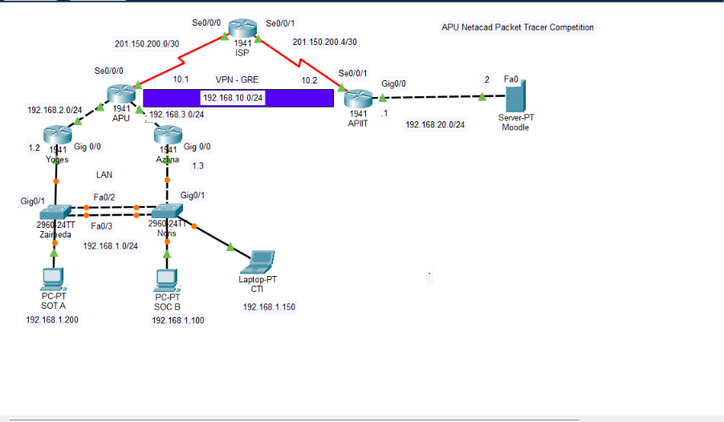

# Lab 10: GRE VPN, HSRP, RIP Redistribution, PAgP and ACL

Practice lab based on a campus Packet Tracer task. The task file is not included; this page documents my own configuration and what I learned.

## Topology



## Scenario

A campus LAN (192.168.1.0/24) with two gateway routers (Yoges and Azlina) running HSRP, connected to router APU. APU reaches router APIIT through a GRE tunnel over an ISP. APIIT hosts the Moodle server (192.168.20.0/24). Two switches (Zaireeda and Noris) are joined by a 2-link EtherChannel.

| Link | Network |
|------|---------|
| LAN | 192.168.1.0/24 |
| Yoges - APU | 192.168.2.0/24 |
| Azlina - APU | 192.168.3.0/24 |
| GRE tunnel | 192.168.10.0/24 |
| APU - ISP | 201.150.200.0/30 |
| ISP - APIIT | 201.150.200.4/30 |
| APIIT - Moodle | 192.168.20.0/24 |

## Requirements

- HSRP: Yoges active (priority 150, preempt), Azlina standby, virtual IP 192.168.1.1
- RIPv2 on the LAN side and the tunnel
- GRE tunnel between APU and APIIT, with static routes through it
- APU redistributes static routes into RIP
- PAgP EtherChannel (both sides `desirable`) on Fa0/2 and Fa0/3 between the switches
- Standard named ACL `BLOCK_CTI` to stop the CTI laptop (192.168.1.150) from reaching Moodle

## Key Configuration

**Yoges (HSRP active)**
```
interface gig0/0
 ip address 192.168.1.2 255.255.255.0
 standby 1 ip 192.168.1.1
 standby 1 priority 150
 standby 1 preempt
 no shutdown
router rip
 version 2
 no auto-summary
 network 192.168.1.0
 network 192.168.2.0
```

**Azlina (HSRP standby)**
```
interface gig0/0
 ip address 192.168.1.3 255.255.255.0
 standby 1 ip 192.168.1.1
 no shutdown
router rip
 version 2
 no auto-summary
 network 192.168.1.0
 network 192.168.3.0
```

**APU (tunnel, RIP, redistribution)**
```
ip route 0.0.0.0 0.0.0.0 201.150.200.2
interface tunnel 0
 ip address 192.168.10.1 255.255.255.0
 tunnel source serial 0/0/0
 tunnel destination 201.150.200.6
ip route 192.168.20.0 255.255.255.0 192.168.10.2
router rip
 version 2
 no auto-summary
 network 192.168.2.0
 network 192.168.3.0
 network 192.168.10.0
 redistribute static metric 1
```

**APIIT (tunnel, routes, ACL)**
```
ip route 0.0.0.0 0.0.0.0 201.150.200.5
interface tunnel 0
 ip address 192.168.10.2 255.255.255.0
 tunnel source serial 0/0/1
 tunnel destination 201.150.200.1
ip route 192.168.1.0 255.255.255.0 192.168.10.1
ip route 192.168.2.0 255.255.255.0 192.168.10.1
ip route 192.168.3.0 255.255.255.0 192.168.10.1
ip access-list standard BLOCK_CTI
 deny host 192.168.1.150
 permit any
interface gig0/0
 ip access-group BLOCK_CTI out
```

**Both switches (PAgP)**
```
interface range fa0/2 - 3
 channel-group 1 mode desirable
 no shutdown
```

## Verification

- `show standby brief`: Yoges is Active with priority 150 and preempt
- `show etherchannel summary`: protocol PAgP, `Po1(SU)`, member ports `(P)`
- `show ip route rip` on Yoges: learns 192.168.20.0 and the tunnel network
- SOT A and SOC B can open the Moodle page; CTI times out

## Troubleshooting Notes (What I Learned)

1. **GRE destination must be the peer's real interface IP.** I first pointed APIIT's tunnel at the ISP-side address (.2) instead of APU's Se0/0/0 (.1). The tunnel still showed up/up because GRE only checks that the destination is reachable, so I confirmed with `ping 192.168.10.2` across the tunnel instead of trusting the interface state.
2. **ACL direction matters.** A standard ACL applied `in` on APIIT Gig0/0 did nothing to traffic heading toward Moodle (0 matches on the deny line). Applying it `out` blocked CTI correctly. The `show access-lists` match counters made this obvious.
3. **PAgP vs LACP.** The bundle came up as LACP after an earlier `mode active`. I removed the channel-group and the port-channel, then re-applied `desirable` on both switches to get PAgP.
4. **Server default gateway.** Moodle needs 192.168.20.1 as its gateway, otherwise it cannot reply to tunnel addresses.
5. **Read the output, do not assume the addressing.** `show ip interface brief` on every router settled the IP mix-ups quickly.
